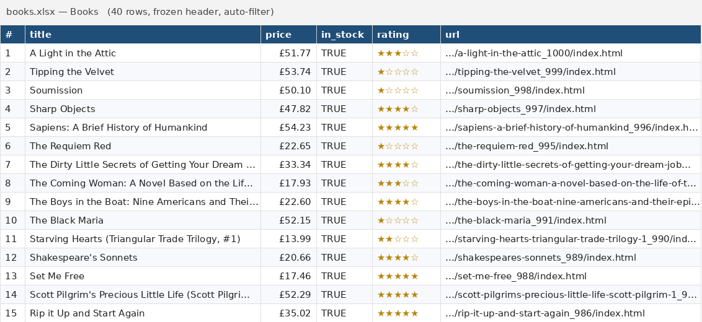

# books-scraper

A small, polite Python web scraper for [books.toscrape.com](https://books.toscrape.com) —
a sandbox site built for scraping practice. It collects book data from the catalogue
(optionally filtered by category), can visit product pages for extra details, and exports
the results to **CSV**, **Excel (XLSX)**, **JSON** or **Google Sheets**.




---

## Features

- **Catalogue crawling** — one page, N pages, or all 50 pages (1000 books), following pagination automatically.
- **Category filter** — `--category "Travel"` (case-insensitive; unknown names print the list of valid ones).
- **Detail pages** (`--details`) — UPC, exact stock count (`In stock (22 available)` → `22`) and category.
- **Exports**
  - CSV (UTF-8 with BOM, opens correctly in Excel)
  - XLSX with styled header, frozen header row, auto filter, auto column widths and `£` price format
  - JSON (pretty-printed)
  - Google Sheets (optional, via a service account)
- **Polite by default** — identifiable `User-Agent`, 1 s delay between requests, retries with exponential backoff on errors / HTTP 429 / 5xx.
- **Readable logs** with progress per page.
- **Tested offline** — pytest suite runs against saved HTML fixtures, no network needed.

## Data collected

| Field          | Type          | Source         | Example                                              |
|----------------|---------------|----------------|------------------------------------------------------|
| `title`        | str           | listing        | `A Light in the Attic`                               |
| `price`        | float (GBP)   | listing        | `51.77`                                              |
| `in_stock`     | bool          | listing        | `True`                                               |
| `availability` | int \| empty  | detail page    | `22`                                                 |
| `rating`       | int (1–5)     | listing        | `3`                                                  |
| `category`     | str \| empty  | filter / detail| `Poetry`                                             |
| `url`          | str           | listing        | `https://books.toscrape.com/catalogue/a-light-in-the-attic_1000/index.html` |
| `image_url`    | str           | listing        | `https://books.toscrape.com/media/cache/2c/da/....jpg` |
| `upc`          | str \| empty  | detail page    | `a897fe39b1053632`                                   |

## Quick start

Requires **Python 3.10+**.

### Linux / macOS

```bash
git clone https://github.com/<your-username>/books-scraper.git
cd books-scraper
python3 -m venv .venv
source .venv/bin/activate
pip install -r requirements.txt

python -m books_scraper --pages 2 --format xlsx
```

### Windows (PowerShell / cmd)

```powershell
git clone https://github.com/<your-username>/books-scraper.git
cd books-scraper
py -m venv .venv
.venv\Scripts\activate
pip install -r requirements.txt

py -m books_scraper --pages 2 --format xlsx
```

Results are saved to `output/books.<format>` unless you pass `--output`.

## CLI usage

```text
py -m books_scraper [-p PAGES | -a] [-c CATEGORY] [-f {csv,xlsx,json}] [-o OUTPUT]
                    [-d DELAY] [--details] [--list-categories]
                    [--sheet SPREADSHEET_ID] [--credentials JSON] [-v]
```

| Option                | Description                                              | Default              |
|-----------------------|----------------------------------------------------------|----------------------|
| `-p, --pages N`       | Number of listing pages to scrape                        | `1`                  |
| `-a, --all`           | Scrape all pages                                         | off                  |
| `-c, --category NAME` | Only this category (case-insensitive)                    | all books            |
| `-f, --format`        | `csv`, `xlsx` or `json`                                  | `csv`                |
| `-o, --output PATH`   | Output file                                              | `output/books.<fmt>` |
| `-d, --delay SEC`     | Pause between requests                                   | `1.0`                |
| `--details`           | Visit each product page (UPC, stock count, category)     | off                  |
| `--list-categories`   | Print all category names and exit                        |                      |
| `--sheet ID`          | Also upload to this Google Sheet (needs `--credentials`) |                      |
| `--credentials FILE`  | Google service-account JSON key                          |                      |
| `-v, --verbose`       | Debug logging                                            | off                  |

### Examples

```bash
# First page to CSV (20 books)
py -m books_scraper

# 5 pages to Excel
py -m books_scraper --pages 5 --format xlsx --output data/books.xlsx

# Whole "Mystery" category with UPC and stock counts, as JSON
py -m books_scraper --category mystery --all --details --format json

# Entire catalogue (1000 books), a bit slower to be extra polite
py -m books_scraper --all --delay 2 --format xlsx

# List available categories
py -m books_scraper --list-categories

# Also push results to Google Sheets
py -m books_scraper --pages 3 --sheet 1AbC...xyz --credentials service-account.json
```

On Linux/macOS replace `py` with `python` (inside the virtual environment).

### Sample log

```text
12:00:01 INFO    Category: Mystery
12:00:02 INFO    Page 1: 20 books (https://books.toscrape.com/catalogue/category/books/mystery_3/index.html)
12:00:03 INFO    Page 2: 12 books (https://books.toscrape.com/catalogue/category/books/mystery_3/page-2.html)
12:00:23 INFO    Details: 20/32
12:00:35 INFO    Details: 32/32
12:00:35 INFO    Saved 32 books to output/books.json
```

### Sample output

Real output of `py -m books_scraper --pages 2 --format xlsx` (40 books; first rows,
`url` / `image_url` columns omitted for width):

| title                                 | price (£) | in_stock | rating |
|---------------------------------------|----------:|:--------:|:------:|
| A Light in the Attic                  | 51.77     | True     | 3      |
| Tipping the Velvet                    | 53.74     | True     | 1      |
| Soumission                            | 50.10     | True     | 1      |
| Sharp Objects                         | 47.82     | True     | 4      |
| Sapiens: A Brief History of Humankind | 54.23     | True     | 5      |

Add `--details` to also fill `category`, exact `availability` (stock count) and `upc`
from each product page.

## Google Sheets export (optional)

1. `pip install gspread google-auth`
2. Create a service account in Google Cloud, enable the **Google Sheets API**, download its JSON key.
3. Share your spreadsheet with the service account's e-mail (Editor).
4. Run with `--sheet <spreadsheet-id> --credentials <key.json>`.

If the libraries or the key file are missing, the local export still completes and the
Sheets step is skipped with a clear warning. Never commit the key file (it is in `.gitignore`).

## Running tests

```bash
pip install -r requirements-dev.txt
pytest
```

Tests use hand-written HTML fixtures that mirror the real site's markup (`tests/fixtures/`)
and a fake HTTP session, so they run fully offline in well under a second.

## Project structure

```text
books-scraper/
├── books_scraper/
│   ├── __init__.py      # package version
│   ├── __main__.py      # enables `python -m books_scraper`
│   ├── cli.py           # argparse CLI, logging, error handling
│   ├── scraper.py       # HTTP session (UA, retries, delay) + crawling
│   ├── parser.py        # pure BeautifulSoup parsing functions
│   ├── exporters.py     # CSV / XLSX / JSON / Google Sheets
│   └── models.py        # Book dataclass
├── tests/
│   ├── fixtures/        # hand-written HTML mirroring the real pages
│   ├── conftest.py      # fixtures + fake session
│   ├── test_parser.py
│   ├── test_scraper.py
│   ├── test_exporters.py
│   └── test_cli.py
├── pyproject.toml
├── requirements.txt
├── requirements-dev.txt
├── LICENSE
└── README.md
```

Design notes: parsing is kept separate from networking, so selectors can be tested
against fixtures and the crawler can be tested with a fake session.

## Ethical scraping

- The target, books.toscrape.com, is a public sandbox **created for scraping practice**.
- The scraper identifies itself with a generic `User-Agent: books-scraper/1.0`.
- A delay between requests (default 1 s) and backoff on 429/5xx keep server load low.
- When adapting this code to real websites: check `robots.txt` and the Terms of Service,
  prefer an official API if one exists, don't collect personal data without a legal basis
  (e.g. GDPR), keep request rates modest, and cache results instead of re-scraping.

## License

[MIT](LICENSE) © 2026 Kyrylo Dubovenko
